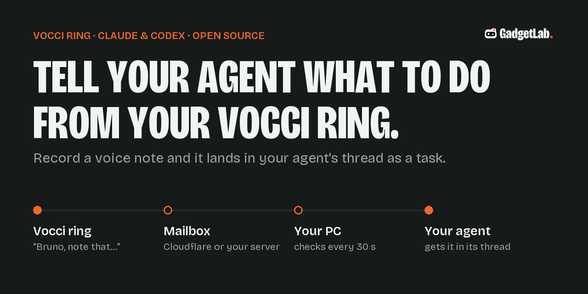

<h1 align="center">vocci-puente</h1>

<p align="center"><b>Tell your agent what to do from your Vocci ring.</b><br>
<a href="README.md">Español</a> · <b>English</b></p>

<p align="center">
  <a href="LICENSE"></a>
  
  
  
  
  
  <a href="https://www.youtube.com/@GadgetLabOficial"></a>
</p>

You tell your **Vocci** ring “Bruno, note that there is a meeting on Tuesday” and, a couple of minutes later, the note shows up by itself in your agent's thread. The agent handles it as if you had typed it there. No phone, no app to open.

- 🎙️ **Say it to the ring and it gets done.** If the note starts with your agent's name, it is for the agent. If not, it is yours and it is not stored.
- 🤖 **For Claude and Codex**, in their desktop apps. One agent or several, each with its own name and thread.
- ☁️ **Free to run.** The mailbox is a Cloudflare Worker on the free plan, or your own server.
- 💤 **Nothing is lost with the PC off.** Notes wait and arrive when it is back on.
- 🔍 **Three code files, no dependencies.** Your agent reads them in a couple of minutes before installing anything.

We built it at [GadgetLab](https://gadgetlab.ai) for our own use, and this is the version to set up at home. It is not an official Vocci product.

> 📺 **New to the Vocci ring?** We test it in depth and show this bridge working on [our YouTube channel](https://www.youtube.com/@GadgetLabOficial) (in Spanish, with English audio and subtitles).

*Puente* means bridge. The code, its commands and its settings are named in Spanish; this page explains each one.

## 🚀 Install: copy and paste this to your agent

```text
Clone https://github.com/GadgetLabAI/vocci-puente into a folder
in my user directory that is not synced to the cloud.
Read PROMPT.en.md and all the code and tell me if anything looks off.
If everything is fine, follow the instructions in PROMPT.en.md
to set it up with me.
```

That is all. Your agent reviews the code, asks you a few questions (its name, which thread the notes go to, whether you have a server or prefer free Cloudflare), configures it and tests it with you. Allow about fifteen minutes.

You only do what an agent should not do for you: sign in to Cloudflare, create the webhook in your Vocci account and store its secret.

> Always ask your agent to review what you download from the internet before running it, this included. That is why the prompt starts there.

## ⚙️ How it works

```
 Vocci ring ──► Vocci (transcribes) ──► signed webhook ──► MAILBOX on the internet
                                                            │  checks the signature
                                                            │  does it start with “Bruno”?
                                                            ▼
 Your agent's thread ◄── delivery on your PC ◄── Bruno's queue (every 30 s)
```

1. **Vocci sends a signed webhook** (`session.completed`) once the note has a transcript.
2. **A mailbox on the internet** checks the signature (HMAC-SHA256) and looks at the first word.
3. If the note starts with an agent's name, it goes to **that agent's queue**. If it names nobody it is a personal note and **nothing of it is stored**.
4. **Your PC reads the queue** every 30 seconds. While there are no notes, no model is used: it is a web request and nothing else.
5. The delivery process **puts the note in the thread** you chose and, once delivery is confirmed, the mailbox deletes the text.

**With the PC off or the app closed, notes wait in the mailbox** and arrive when you are back.

The mailbox can be a **Cloudflare Worker** in your account, on the free plan, or your **own server**. Both use the same core.

## 📦 What is in here

| File | What it is |
| --- | --- |
| [`PROMPT.en.md`](PROMPT.en.md) | The prompt for your agent. |
| `puente.mjs` | The program: setup, checks, delivery and the mailbox for your own server. |
| `buzon/nucleo.mjs` | Signature, routing by name and queue. No dependencies. |
| `buzon/worker.mjs` | The mailbox as a Cloudflare Worker (with a D1 database). |
| `ajustes.ejemplo.json` | The settings: agents, words, destination and rules. |
| `pruebas/` | Tests for the core (`node --test`). |

It needs **Node 20 or later**. There are no dependencies to install; `wrangler` is used through `npx` only for the Cloudflare option.

## 🔒 The bridge only delivers

The bridge carries a message from one place to another and **gives your agent no new permission**. With a voice note it can do what it can do when you type: whatever you already allow.

The only thing it adds is that a transcript can get a name or a figure wrong. So each note travels with two cautious rules:

- anything that goes out or cannot be undone (sending an email, publishing, buying, deleting) is prepared and waits for your yes;
- if the transcript is unclear, the agent asks.

They are yours: they live under `reglas` in the settings, and you can change them, remove them or add others whenever you like (“emails to my own address go out directly”, for instance).

## 🎛️ Settings

They live outside the repository, in `~/.vocci-puente/ajustes.json`:

```json
{
  "idioma": "en",
  "usuario": "Your name",
  "buzon": { "tipo": "cloudflare", "url": "", "nombre_worker": "vocci-buzon", "d1_id": "" },
  "agentes": [
    {
      "id": "bruno",
      "nombre": "Bruno",
      "palabras": ["runo", "pruno", "bruna", "brunno"],
      "tipo": "claude",
      "destino": "Exact name of the Claude thread"
    }
  ],
  "reglas": ["…"],
  "espera_segundos": 30
}
```

- **`idioma`** (language): `es` or `en`, for the text that goes with each note.
- **`usuario`** (user): your name.
- **`buzon`** (mailbox): `tipo` is `cloudflare` or `servidor` (own server).
- **`agentes`** (agents): add one entry per agent. Each has its own word and thread, and you can mix Claude and Codex.
- **`palabras`** (words): the ways transcription tends to misspell the name. They only count at the start of the note, possibly after a filler word (“Hey, Bruno…”).
- **`tipo` and `destino`** (type and destination): for `claude`, the name of the desktop app thread, which must be unique; for `codex`, the conversation identifier.
- **`reglas`** (rules): the lines that travel with each note.
- **`espera_segundos`**: seconds between checks of the queue.

Every time you change agents or words you have to publish the mailbox again, because the mailbox decides whose note each one is.

## 🛠️ Setting it up by hand

<details>
<summary>With Cloudflare (no server)</summary>

```bash
node puente.mjs iniciar
```

Edit `~/.vocci-puente/ajustes.json`. Then:

```bash
npx wrangler login
```

```bash
npx wrangler d1 create vocci-buzon
```

Copy the `database_id` it returns into `buzon.d1_id` in the settings and go on:

```bash
node puente.mjs wrangler
```

```bash
npx wrangler deploy
```

Copy the `https://…workers.dev` address it returns into `buzon.url` and upload the read token (the program sends it without showing it):

```bash
node puente.mjs token-cloudflare
```

In `my.vocci.ai` → Developer → Webhooks create an endpoint with the address `https://…workers.dev/vocci` and the event `session.completed`. Vocci gives you a secret. Enter it yourself, in your terminal, without pasting it into any chat:

```bash
npx wrangler secret put SECRETO_WEBHOOK
```

Check and start:

```bash
node puente.mjs comprobar --a-fondo
```

```bash
node puente.mjs arranque instalar
```

Press “Send test event” in Vocci: within a minute a test message must appear in the thread. Then record a real note that starts with the agent's name.

</details>

<details>
<summary>On your own server</summary>

`node puente.mjs env-servidor` writes `~/.vocci-puente/vocci-buzon.env` with the token and the agents. Upload it to the server with 600 permissions, fill in `SECRETO_WEBHOOK` there and run `node puente.mjs servidor` as a service (it listens on `127.0.0.1:18771`). Your proxy must publish it over HTTPS; if you hang it from a path, put it in `PREFIJO` (for example `/hooks/vocci-buzon`). The Vocci webhook points to `<your address>/vocci`.

</details>

## ⌨️ Commands

| Command | What for |
| --- | --- |
| `iniciar` | Creates the private folder, the example settings and the read token. |
| `comprobar [--a-fondo]` | Checks settings, mailbox and destinations. `--a-fondo` (thorough) looks up the Claude threads (one small call). |
| `probar <agent> "text"` | Delivers a simulated note to the thread, bypassing the mailbox. |
| `repartir [--una-vez]` | The delivery process (`--una-vez`: run once). |
| `arranque instalar\|quitar\|estado` | Autostart with your session: install, remove, status. |
| `liberar <session>` | Retries a Codex note held back after a doubtful delivery. |
| `simular "text"` | Development only: sends the mailbox a webhook signed with the secret in the `VOCCI_SECRETO` variable. |

## 🩺 If a note does not arrive

Look at `~/.vocci-puente/puente.log` first (its messages are in Spanish). The usual causes:

- **“el comando claude no tiene la sesión iniciada”** (the `claude` command is not signed in). The terminal has its own sign-in, separate from the app's, and it sometimes expires. Fix it with `claude auth login`. Notes are not lost: they wait in the mailbox.
- **“hilo no encontrado”** (thread not found) or **“aparece 2 veces”** (appears twice). The Claude app is closed, or the thread name changed or is no longer unique.
- **“la conversación está ocupada”** (the conversation is busy, Codex). The note waits until the agent finishes.
- **Nothing in the log.** The note never reached the mailbox: Vocci takes a minute or two to transcribe, and the transcript may have spelled the name differently. Add that spelling to `palabras`.

## 📌 Good to know

- **Claude.** A program cannot write to a thread in the app, but another Claude session can. For each note a minimal `claude -p` is launched (Haiku model, no connectors and only three tools: `ListAgents`, `SendMessage` and `ToolSearch`) that finds the thread by name and passes the message on. It uses a few seconds of your plan per note. The Claude app must be open.
- **That delivery session can write to any of your threads**, not only the chosen one. The note text travels marked as a package it must not interpret, and the program only counts the delivery as good if it went to the right thread, but that is a barrier made of instructions, not a technical one.
- **Codex.** It uses the local MCP server that ships with the app (`codex_app`, tools `read_thread` and `send_message_to_thread`), with no model use. It is an internal part of the app: a Codex update may change it. If the conversation is busy, the note waits. If a send is cut halfway it is not resent blindly: it is held until you look at it.
- **Who is speaking is not checked.** Any recording from your ring whose first sentence starts with the agent's name is a request, whoever says it.
- **A process stays running.** The autostart launches the delivery process without a window when you sign in. Remove it with `node puente.mjs arranque quitar`.
- **Privacy.** Personal notes are not stored. Agent notes stay in the mailbox until delivered; then the text is deleted and only the recording identifier is kept, to avoid repeating it, for 30 days. The log holds no note text and no secrets.
- **Secrets.** The webhook secret lives only in the mailbox. The read token, in `~/.vocci-puente/secretos.json` and in the mailbox. Neither goes in the repository or the settings.

## ✅ What has been tested

| | Status |
| --- | --- |
| Windows 11 + Claude + Cloudflare, with real notes from the ring | Tested end to end |
| Setup done by a fresh agent with only the prompt | Tested with Claude |
| Windows 11 + Codex | Delivery tested with a simulated note (`probar`); not yet tested end to end with a note from the ring |
| Mailbox on your own server | Tested locally |
| Autostart on macOS (launchd) and Linux (systemd) | Written, untested |

If you set it up on something we have not tested and it fails, open an issue: it helps us fix it.

## 🧩 Other agents and other recorders

**Other agents.** Today it delivers to Claude and Codex. The mailbox and the queue know nothing about the agent: adding another one (Gemini, Grok or whichever you use) only takes a new delivery function in `puente.mjs`, as long as that agent has a way to receive a message from outside. If you get it working with yours, tell us in an issue or send a change.

**Other recorders.** It is built for the Vocci ring, which is the one we have. Any recorder that sends a webhook with the transcript can use the same mailbox by changing how the event is read (`buzon/nucleo.mjs`). One that sends no notifications would have to be polled every few minutes.

## 📄 License

MIT. Made by [GadgetLab](https://gadgetlab.ai), a channel where we test AI gadgets and build things on top of them. If it is useful to you, a ⭐ here and a subscription to the [channel](https://www.youtube.com/@GadgetLabOficial) help more people find it.
