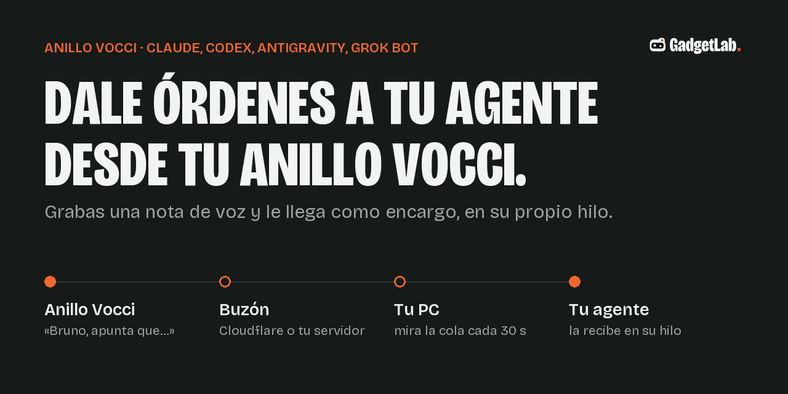

<h1 align="center">vocci-puente</h1>

<p align="center"><b>Dale órdenes a tu agente desde tu anillo Vocci.</b><br>
<b>Español</b> · <a href="README.en.md">English</a></p>

<p align="center">
  <a href="LICENSE"></a>
  
  
  
  
  
  
  
  <a href="https://www.youtube.com/@GadgetLabOficial"></a>
</p>

Le dices al anillo **Vocci** «Bruno, apunta que el martes hay reunión» y, un par de minutos después, la nota aparece sola en el hilo de tu agente. Él la atiende como si se la hubieras escrito allí. Sin sacar el móvil y sin abrir ninguna app.

- 🎙️ **Se lo dices al anillo y lo hace.** Si la nota empieza por el nombre de tu agente, es para él. Si no, es tuya y no se guarda.
- 🤖 **Para Claude, Codex, Antigravity y Grok Bot**, en sus apps de escritorio. Uno o varios agentes, cada uno con su nombre y su hilo.
- ☁️ **Gratis de mantener.** El buzón es un Cloudflare Worker del plan gratuito, o tu propio servidor.
- 💤 **Con el PC apagado no se pierde nada.** Las notas esperan y entran al encenderlo.
- 🔍 **Tres archivos de código, sin dependencias.** Tu agente los lee en un par de minutos antes de instalar nada.

Lo hicimos en [GadgetLab](https://gadgetlab.ai) para nuestro propio uso y esta es la versión para montarlo en casa. No es un producto oficial de Vocci.

> 📺 **¿No conoces el anillo Vocci?** Lo probamos a fondo y enseñamos este puente funcionando en [nuestro canal de YouTube](https://www.youtube.com/@GadgetLabOficial).

## 🚀 Instalarlo: copia y pega esto a tu agente

```text
Clona https://github.com/GadgetLabAI/vocci-puente en una carpeta
de mi usuario que no esté sincronizada con la nube.
Lee PROMPT.md y todo el código y dime si ves algo raro.
Si está todo bien, sigue las instrucciones de PROMPT.md
para montarlo conmigo.
```

Eso es todo. Tu agente revisa el código, te hace unas preguntas (cómo se llama, a qué hilo van las notas, si tienes servidor o prefieres Cloudflare gratis), lo configura y lo prueba contigo. Calcula unos quince minutos.

Tú solo haces lo que un agente no debe hacer por ti: iniciar sesión en Cloudflare, crear el webhook en tu cuenta de Vocci y guardar su secreto.

> Pide siempre a tu agente que revise lo que te bajas de internet antes de ejecutarlo, esto incluido. Por eso el prompt empieza por ahí.

## ⚙️ Cómo funciona

```
 Anillo Vocci ──► Vocci (transcribe) ──► webhook firmado ──► BUZÓN en internet
                                                              │  comprueba la firma
                                                              │  ¿empieza por «Bruno»?
                                                              ▼
 Hilo de tu agente ◄── repartidor en tu PC ◄── cola de Bruno (cada 30 s)
```

1. **Vocci manda un webhook firmado** (`session.completed`) cuando la nota ya tiene transcripción.
2. **Un buzón en internet** comprueba la firma (HMAC-SHA256) y mira la primera palabra.
3. Si la nota empieza por el nombre de un agente, pasa a **su cola**. Si no nombra a nadie es una nota personal y **no se guarda nada de ella**.
4. **Tu PC lee la cola** cada 30 segundos. Mientras no hay notas no se gasta ningún modelo: es una petición web y nada más.
5. El repartidor **entrega la nota en el hilo** que hayas elegido y, con la entrega confirmada, el buzón borra el texto.

**Con el PC apagado o la app cerrada, las notas esperan en el buzón** y entran al volver.

El buzón puede ser un **Cloudflare Worker** en tu cuenta, con el plan gratis, o tu **servidor propio**. Los dos usan el mismo núcleo.

## 📦 Qué hay aquí

| Archivo | Qué es |
| --- | --- |
| [`PROMPT.md`](PROMPT.md) | El prompt para tu agente. |
| `puente.mjs` | El programa: puesta en marcha, comprobaciones, repartidor y buzón para servidor propio. |
| `buzon/nucleo.mjs` | Firma, reparto por nombre y cola. Sin dependencias. |
| `buzon/worker.mjs` | El buzón como Cloudflare Worker (con una base D1). |
| `ajustes.ejemplo.json` | Los ajustes: agentes, palabras, destino y reglas. |
| `pruebas/` | Pruebas del núcleo (`node --test`). |

Hace falta **Node 20 o superior**. No hay dependencias que instalar; `wrangler` se usa con `npx` solo para la opción de Cloudflare.

## 🔒 El puente solo entrega

El puente lleva un mensaje de un sitio a otro y **no le da a tu agente ningún permiso nuevo**. Con una nota de voz podrá hacer lo mismo que cuando le escribes: lo que tú ya le tengas permitido.

Lo único que añade es que una transcripción puede equivocarse con un nombre o una cifra. Por eso cada nota viaja con dos reglas de prudencia:

- lo que sale hacia fuera o no se puede deshacer (enviar un correo, publicar, comprar, borrar) se prepara y espera tu sí;
- si la transcripción no se entiende, el agente pregunta.

Son tuyas: están en `reglas`, en los ajustes, y puedes cambiarlas, quitarlas o añadir otras cuando quieras («los correos a mi dirección salen directos», por ejemplo).

## 🎛️ Ajustes

Viven fuera del repositorio, en `~/.vocci-puente/ajustes.json`:

```json
{
  "idioma": "es",
  "usuario": "Tu nombre",
  "buzon": { "tipo": "cloudflare", "url": "", "nombre_worker": "vocci-buzon", "d1_id": "" },
  "agentes": [
    {
      "id": "bruno",
      "nombre": "Bruno",
      "palabras": ["runo", "pruno", "bruna", "brunno"],
      "tipo": "claude",
      "destino": "Nombre exacto del hilo de Claude"
    }
  ],
  "reglas": ["…"],
  "espera_segundos": 30
}
```

- **`palabras`**: las formas en que la transcripción suele escribir mal el nombre. Solo cuentan al principio de la nota, quizá tras una muletilla («Oye, Bruno…»).
- **`tipo` y `destino`**: en `claude`, el nombre del hilo de la app de escritorio, que tiene que ser único; en `codex` y en `antigravity`, el identificador de la conversación; en `grokbot`, la URL del webhook de una rutina (la clave va aparte, con `node puente.mjs clave <agente>`).
- **Varios agentes**: añade más entradas. Cada uno tiene su palabra y su hilo, y pueden mezclarse de los cuatro tipos.
- **`idioma`**: `es` o `en`, para el texto que acompaña a la nota.

Cada vez que cambies agentes o palabras hay que volver a publicar el buzón, porque es él quien decide de quién es cada nota.

## 🛠️ Montarlo a mano

<details>
<summary>Con Cloudflare (sin servidor)</summary>

```bash
node puente.mjs iniciar
```

Edita `~/.vocci-puente/ajustes.json`. Después:

```bash
npx wrangler login
```

```bash
npx wrangler d1 create vocci-buzon
```

Copia el `database_id` que devuelve a `buzon.d1_id` en los ajustes y sigue:

```bash
node puente.mjs wrangler
```

```bash
npx wrangler deploy
```

Copia la dirección `https://…workers.dev` que devuelve a `buzon.url` y sube el token de lectura (el programa lo manda sin enseñarlo):

```bash
node puente.mjs token-cloudflare
```

En `my.vocci.ai` → Developer → Webhooks crea un endpoint con la dirección `https://…workers.dev/vocci` y el evento `session.completed`. Vocci te da un secreto. Ponlo tú, en tu terminal, sin pegarlo en ningún chat:

```bash
npx wrangler secret put SECRETO_WEBHOOK
```

Comprueba y arranca:

```bash
node puente.mjs comprobar --a-fondo
```

```bash
node puente.mjs arranque instalar
```

Pulsa «Send test event» en Vocci: en menos de un minuto debe aparecer en el hilo un mensaje de prueba. Después graba una nota real que empiece por el nombre del agente.

</details>

<details>
<summary>En tu servidor</summary>

`node puente.mjs env-servidor` escribe `~/.vocci-puente/vocci-buzon.env` con el token y los agentes. Súbelo al servidor con permisos 600, rellena allí `SECRETO_WEBHOOK` y lanza `node puente.mjs servidor` como servicio (escucha en `127.0.0.1:18771`). Tu proxy tiene que publicarlo con HTTPS; si lo cuelgas de una ruta, ponla en `PREFIJO` (por ejemplo `/hooks/vocci-buzon`). El webhook de Vocci apunta a `<tu dirección>/vocci`.

</details>

## ⌨️ Órdenes

| Orden | Para qué |
| --- | --- |
| `iniciar` | Crea la carpeta privada, los ajustes de ejemplo y el token de lectura. |
| `comprobar [--a-fondo]` | Revisa ajustes, buzón y destinos. `--a-fondo` busca los hilos de Claude (gasta una llamada pequeña). |
| `probar <agente> "texto"` | Entrega una nota simulada al hilo, sin pasar por el buzón. |
| `repartir [--una-vez]` | El repartidor. |
| `arranque instalar\|quitar\|estado` | Arranque automático con tu sesión. |
| `liberar <sesión>` | Reintenta una nota retenida por entrega dudosa. |
| `clave <agente>` | Guarda la clave del webhook de un agente de Grok Bot. Se pega en la terminal; no queda en los ajustes ni en el registro. |
| `simular "texto"` | Solo para desarrollo: manda al buzón un webhook firmado con el secreto de la variable `VOCCI_SECRETO`. |

## 🩺 Si una nota no llega

Mira primero `~/.vocci-puente/puente.log`. Lo habitual:

- **«el comando claude no tiene la sesión iniciada».** La terminal lleva su propio inicio de sesión, aparte del de la app, y a veces caduca. Se arregla con `claude auth login`. Las notas no se pierden: esperan en el buzón.
- **«hilo no encontrado» o «aparece 2 veces».** La app de Claude está cerrada, o el nombre del hilo ha cambiado o ya no es único.
- **«la conversación está ocupada»** (Codex). La nota espera a que el agente termine.
- **No hay nada en el registro.** La nota no ha llegado al buzón: Vocci tarda uno o dos minutos en transcribir, y la transcripción puede haber escrito el nombre de otra forma. Añádela a `palabras`.

## 📌 Lo que conviene saber

- **Claude.** Un programa no puede escribir en un hilo de la app, pero otra sesión de Claude sí. Por cada nota se lanza un `claude -p` mínimo (modelo Haiku, sin conectores y con solo tres herramientas: `ListAgents`, `SendMessage` y `ToolSearch`) que busca el hilo por su nombre y le pasa el mensaje. Gasta unos segundos de tu plan por nota. La app de Claude tiene que estar abierta.
- **Ese repartidor puede escribir a cualquiera de tus hilos**, no solo al elegido. El texto de la nota viaja marcado como un paquete que no debe interpretar, y el programa solo da la entrega por buena si fue al hilo correcto, pero es una barrera de instrucciones, no técnica.
- **Codex.** Se usa el servidor MCP local que trae la app (`codex_app`, herramientas `read_thread` y `send_message_to_thread`), sin gastar modelo. Es una pieza interna de la app: una actualización de Codex puede cambiarla. Si la conversación está ocupada, la nota espera. Si un envío se corta a medias no se reenvía a ciegas: queda retenida hasta que lo mires.
- **Antigravity.** Se usa el comando que trae la propia app (`agentapi send-message`), que escribe en la conversación por su identificador, sin gastar modelo hasta que el agente la atiende. Antigravity tiene que estar abierto. El agente recibe la nota como un mensaje del sistema, no como si la hubieras tecleado tú. Es una pieza interna de la app: una actualización puede cambiarla. Si un envío se corta a medias, la nota queda retenida.
- **Grok Bot.** Se le pide al bot, en su chat, que cree una rutina que se active con un webhook; la URL y la clave salen en la ficha de esa rutina (panel del bot → Rutinas). Cada nota arranca esa rutina con el mensaje como contexto, así que cada encargo es una ejecución nueva de la rutina, no un mensaje en una conversación abierta. Corre en la nube de Grok Bot: no hace falta tener la app abierta. La clave se guarda en `~/.vocci-puente/secretos.json`.
- **Quién habla no se comprueba.** Cualquier grabación de tu anillo cuya primera frase empiece por el nombre del agente es un encargo, la diga quien la diga.
- **Queda un proceso encendido.** El arranque automático lanza el repartidor sin ventana al iniciar sesión. Se quita con `node puente.mjs arranque quitar`.
- **Privacidad.** Las notas personales no se guardan. Las de los agentes están en el buzón hasta que se entregan; entonces se borra el texto y queda solo el identificador de la grabación, para no repetirla, durante 30 días. El registro no lleva texto de notas ni claves.
- **Claves.** El secreto del webhook vive solo en el buzón. El token de lectura, en `~/.vocci-puente/secretos.json` y en el buzón. Ninguno va en el repositorio ni en los ajustes.

## ✅ Qué está probado

| | Estado |
| --- | --- |
| Windows 11 + Claude + Cloudflare, con notas reales del anillo | Probado de punta a punta |
| Montaje hecho por un agente nuevo solo con el prompt | Probado con Claude |
| Windows 11 + Codex | Entrega probada con una nota simulada (`probar`); sin probar aún con una nota del anillo de punta a punta |
| Windows 11 + Antigravity + Cloudflare, con una nota real del anillo | Probado de punta a punta |
| Windows 11 + Grok Bot + Cloudflare, con una nota real del anillo | Probado de punta a punta |
| Buzón en servidor propio | Probado en local |
| Arranque automático en macOS (launchd) y Linux (systemd) | Escrito, sin probar |

Si lo montas en algo que no hemos probado y falla, abre una incidencia: nos ayuda a arreglarlo.

## 🧩 Otros agentes y otras grabadoras

**Otros agentes.** Hoy entrega a Claude, Codex, Antigravity y Grok Bot. El buzón y la cola no saben nada del agente: para añadir otro solo hace falta una función de entrega nueva en `puente.mjs`, siempre que ese agente tenga una forma de recibir un mensaje desde fuera. Si lo consigues con el tuyo, cuéntanoslo en una incidencia o manda un cambio.

**Otras grabadoras.** Está hecho para el anillo Vocci, que es el que tenemos. Cualquier grabadora que mande un webhook con la transcripción puede usar el mismo buzón cambiando cómo se lee el evento (`buzon/nucleo.mjs`). Una que no mande avisos tendría que consultarse cada pocos minutos.

## 📄 Licencia

MIT. Hecho por [GadgetLab](https://gadgetlab.ai), un canal donde probamos gadgets con IA y les construimos cosas encima. Si te sirve, una ⭐ aquí y una suscripción al [canal](https://www.youtube.com/@GadgetLabOficial) nos ayudan a que lo encuentre más gente.
